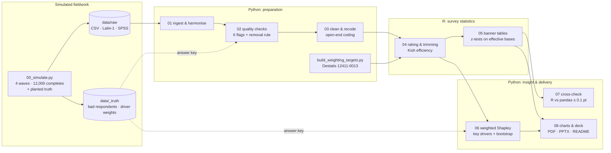

# Mosaik Bank Customer Experience Tracker 2026

[](https://github.com/mohammedelsayed741996-blip/mosaik-cx-tracker/actions/workflows/tests.yml)   

A four-wave customer-experience tracking study for a German digital bank, built end to end the way a market research agency would run it: raw survey exports → quality checks → weighting → banner tables with significance testing → key driver analysis → client deck.

> **All survey data is simulated and all brands are fictional** ("Mosaik Bank", "Volta", "Atlas Direkt", "Sparhaus", "Pebble"). The population targets used for weighting are **official Destatis figures**. The simulator plants a known truth (bad respondents, NPS drivers, wave effects), so every analysis step can be checked against the answer it should find.

## Results at a glance

| | |
|---|---|
| **Key drivers of NPS** (weighted Shapley regression, R² = 0.33, n = 2,204 Mosaik customers) | **Fees / value for money explains 40 %** of the explained variance, **app ease 28 %** – together about 69 % |
| **Card fee (Q3)** | NPS fell **15 points** W2 → W3 (significant) |
| **App relaunch (Q4)** | NPS won back **12 points** W3 → W4 (significant); app ease top-2-box rose 11 points to 76 % |
| **Priority for the client** | Fees: highest importance (40 %) but only 28 % satisfied → fix the fee story first |
| **Data quality** | 569 of 12,000 interviews removed (4.7 %); recall and precision **1.000** against the planted bad respondents on all 6 checks |
| **Verification** | Every R number recomputed independently in pandas (`src/07_crosscheck.py`); **64 pytest tests** run on every push in GitHub Actions |

Full deck: [`Mosaik_CX_Tracker_2026_PREVIEW.pdf`](Mosaik_CX_Tracker_2026_PREVIEW.pdf). Bases and significance rules are on every slide.

<!-- KEY-CHARTS:START (written by src/08_charts_deck.py; do not edit by hand) -->

_Run the pipeline (see [How to run](#how-to-run)): `src/08_charts_deck.py` replaces this block with the headline findings and the three strongest charts._

<!-- KEY-CHARTS:END -->

## The client question

Mosaik Bank introduced a €4.90 monthly card fee in Q3 2026 and relaunched its app in Q4. The tracker answers:

1. How did NPS move across the four waves, and are the changes statistically significant?
2. Which parts of the experience drive NPS, and which should Mosaik fix first?
3. Which customer groups moved most?
4. How does Mosaik's brand funnel compare with its competitors'?

## Study design

| Element | Specification |
| --- | --- |
| Method | Online panel survey (CAWI), about 14 minutes |
| Target group | Adults 18-69 in Germany with a current account and online banking |
| Waves | W1 Mar 2026 · W2 Jun 2026 · W3 Sep 2026 · W4 Dec 2026 |
| Sample | About 3,000 completes per wave, about 2,850 after quality checks; about 640 Mosaik customers per wave |
| Weighting | Raking per wave to Destatis 12411-0013 (31.12.2025): age band × gender × region, trimmed to 0.3-3.0 |
| Significance | Column-letter z-tests on effective bases, 95% level; NPS with design-based standard errors (R `survey`) |
| Questionnaire | Screener, banking relationship, brand funnel, NPS, 8 satisfaction attributes, open end, service, attitudes, demographics; every question, code and routing rule is in [`config/codebook.yaml`](config/codebook.yaml) |

## Architecture



## What the pipeline does

| Step | Tool | What happens | Checked by |
| --- | --- | --- | --- |
| `src/00_simulate.py` | Python | 4 waves of messy exports + the planted truth in `data/_truth/` | same seed → identical files |
| `src/01_ingest_harmonise.py` | Python | Reads CSV (UTF-8, Latin-1) and SPSS, fixes renamed columns, date and duration formats, typed states and ages, garbled umlauts | cell-by-cell match with the undamaged answers |
| `src/02_quality_checks.py` | Python | Speeders, straightliners, attention check, duplicates, gibberish (incl. keyboard runs), logic rules → `outputs/quality_report.md` | recall / precision vs planted bad respondents |
| `src/03_clean_recode.py` | Python | Missing codes → NA with reasons, derived variables, open-end coding (8-code frame), clean file as parquet / CSV / SPSS | routing and code checks; coding accuracy vs truth |
| `src/build_weighting_targets.py` | Python | Destatis 12411-0013 → `config/weighting_targets.csv` | male + female = total in every cell; totals vs a second source |
| `R/04_weighting.R` | R | Raking per wave, trimming, Kish efficiency report | margins within 0.5 pt of target |
| `R/05_tables_sigtests.R` | R | Banner tab book (`banners.xlsx`), NPS trend with SE and CI | unit tests in `R/tests/` |
| `src/06_key_drivers.py` | Python | Weighted Shapley regression, bootstrap intervals, priority matrix | top 3 drivers vs planted weights |
| `src/07_crosscheck.py` | Python | Recomputes every R number in pandas | fails if anything differs by > 0.1 pt |
| `src/08_charts_deck.py` | Python | 12 client slides + appendix, deck PDF / PPTX, this README block | titles are written from the data |

## Data quality, in one paragraph

About 4.7% of interviews are removed: any hard flag (failed attention check, duplicate panel ID, inconsistent answers) or two or more soft flags (speeding, straightlining, gibberish). A single soft flag is kept, because fast honest readers exist. Against the planted truth the checks reach full recall and precision. The report is open about one gap: non-customers who rushed and answered at random carry only a speed flag, so the rule keeps them. See [`outputs/quality_report.md`](outputs/quality_report.md).

## How to run

```bash
pip install -r requirements.txt
Rscript -e 'install.packages(c("survey", "openxlsx"))'

python src/00_simulate.py
python src/01_ingest_harmonise.py
python src/02_quality_checks.py
python src/03_clean_recode.py
python src/build_weighting_targets.py
Rscript R/tests/test_utils_sig_letters.R
Rscript R/04_weighting.R
Rscript R/05_tables_sigtests.R
python src/06_key_drivers.py
python src/07_crosscheck.py
python src/08_charts_deck.py

pytest -q        # 64 tests, ~10 s
```

GitHub Actions runs the pytest suite on every push ([`.github/workflows/tests.yml`](.github/workflows/tests.yml)).
The R unit tests (`R/tests/`) are run locally as part of the pipeline above.

## Repository structure

```
config/        codebook, wave mappings, consistency rules, weighting targets
data/raw/      the four exports as delivered (simulated)
data/_truth/   planted answers - read only by tests and evaluation steps
data/external/ the Destatis extract used for weighting
data/clean/    clean, weighted analysis files
src/           Python steps 00-08
R/             weighting, tables, significance tests (+ unit tests)
outputs/       quality report, tables, charts, deck
tests/         pytest suite (64 tests)
.github/       CI workflow (pytest on every push)
```

## Limitations

- The data is simulated. Real fieldwork brings problems a simulator does not plant, and the quality checks were written knowing what the simulator does, so their scores are optimistic.
- Significance letters use no multiple-comparison correction (common practice in market research), so a few letters per table are expected false positives.
- Age bands are too small for wave-on-wave reading; the deck compares under-30s with 30+ instead.

## How AI was used

See [`AI_USAGE.md`](AI_USAGE.md): what was drafted with AI, what was wrong in those drafts, and how each part was verified.

## License

[MIT](LICENSE) © 2026 Mohamed Abdelrasoul
